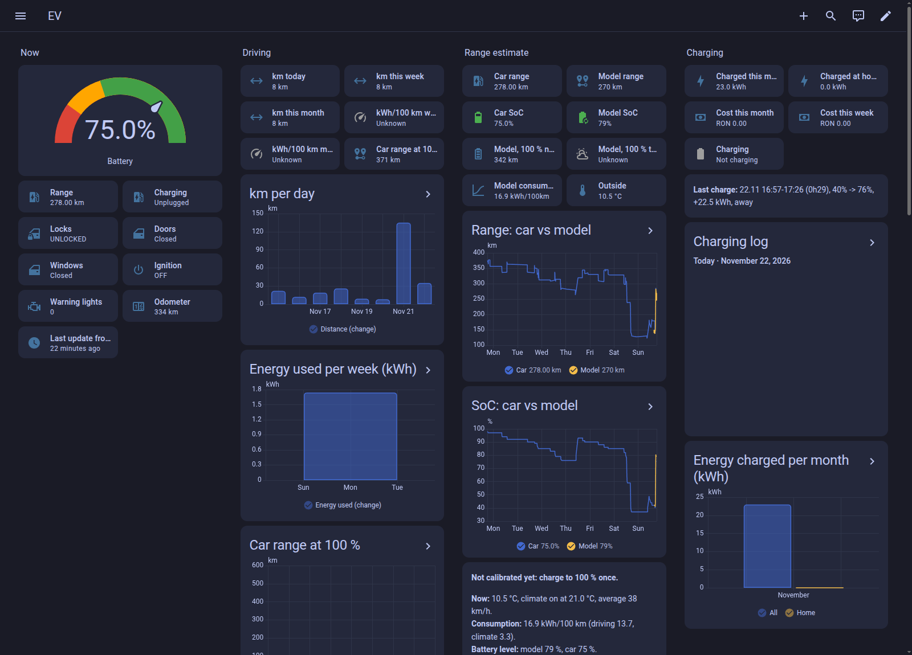

# Ford EV for Home Assistant

A Home Assistant integration for Ford electric vehicles. It adds what the car's own app does not give you:

- **An independent range estimate.** It accounts for outside temperature and cabin climate, and recalibrates itself every time you charge to 100 %. This helps with LFP batteries, whose displayed state of charge drifts between full charges.
- **Reports.** Distance per day, week and month; energy used and charged; consumption; a charging log; charging cost.
- **Notifications.** Car left unlocked, door or window open, plug-in reminder, warning lights, charging finished, car data stopped, night activity, and a weekly summary.
- **A ready-made dashboard** that builds itself from your vehicle's entities.



Everything is set up from the Home Assistant UI. There is no YAML to write and no entity ID to edit.

It builds on the [FordConnect Query](https://github.com/marq24/ha-fordconnect-query) integration, which talks to Ford. This integration only reads FordConnect Query's entities. It makes no network calls of its own.

> This project is not affiliated with, endorsed by, or connected to Ford Motor Company.

## Contents

- [Requirements](#requirements)
- [Installation](#installation)
- [Setup](#setup)
- [Options](#options)
- [Dashboard](#dashboard)
- [Notifications and events](#notifications-and-events)
- [How the range model works](#how-the-range-model-works)
- [Entity reference](#entity-reference)
- [Privacy](#privacy)
- [Troubleshooting](#troubleshooting)
- [License](#license)

## Requirements

- A Ford battery-electric vehicle supported by FordConnect Query (EU, UK and North America).
- Home Assistant **2026.5** or newer.
- [FordConnect Query](https://github.com/marq24/ha-fordconnect-query) installed, set up and showing your vehicle. Follow its own instructions first.
- Optional:
  - the Home Assistant Companion app on your phone, for push notifications;
  - an outdoor temperature sensor;
  - a weather entity. The default `weather.forecast_home` is enough.

## Installation

### With HACS (recommended)

1. In Home Assistant, open **HACS**.
2. Open the menu (three dots, top right) and choose **Custom repositories**.
3. Enter `https://github.com/mihaics/fordev4ha`, choose the type **Integration**, and select **Add**.
4. Search HACS for **Ford EV**, open it and select **Download**.
5. Restart Home Assistant.

### Manual

1. Download the latest release from the [releases page](https://github.com/mihaics/fordev4ha/releases).
2. Copy the folder `custom_components/ford_ev` into the `custom_components` folder of your Home Assistant configuration directory. The result should be `config/custom_components/ford_ev/manifest.json`.
3. Restart Home Assistant.

## Setup

1. Go to **Settings > Devices & services > Add integration** and search for **Ford EV**.
2. **Vehicle:** pick your car from the list of vehicles found in FordConnect Query. If you have several, add the integration once per car.
3. **Usable battery capacity (kWh):** FordConnect Query does not report it, so enter it yourself. Use the *usable* (net) capacity from your vehicle's documentation or specification sheet, not the gross capacity. It is used for every energy figure and for the range model. If you get it wrong, correct it later under **Configure**, then run the [reset action](#how-the-range-model-works).
4. **Outside temperature sensor** and/or **weather entity:** at least one is required.
   - The sensor is preferred when it has a value.
   - The weather entity is the fallback, and it provides tomorrow's forecast for the "range at 100 % tomorrow" estimate.

After setup you get one device, **EV**, with the entities listed [below](#entity-reference). With several vehicles, each device is named **EV *vehicle name***. It is linked to the FordConnect Query device.

## Options

Open **Settings > Devices & services > Ford EV > Configure**. The integration reloads after you save.

| Option | Default | Meaning |
|---|---|---|
| Notification services | none | `notify` services to send notifications to, for example `mobile_app_<your phone>`. Nothing is sent while this and the next option are empty. |
| Notification entities | none | `notify.*` entities (for example a display) to send notifications to. |
| Dashboard path | empty | Opened when a phone notification is tapped, for example `/dashboard-ford-ev`. |
| Electricity price entity | none | A sensor or input number holding the price per kWh in your currency. Takes precedence over the fixed price. |
| Fixed electricity price | none | Price per kWh, used when no price entity is set. |
| Public charging price entity / fixed public charging price | none | Price per kWh away from home, as entity or fixed value. Without one, charging away from home costs nothing. |
| Solar power sensor | none | Current solar production (W or kW). When set, solar power above the house base load covers home charging first. A forecast sensor, such as Forecast.Solar's power now, works as an estimate. |
| Solar kWh price entity / fixed solar kWh price | none (0) | What a solar kWh used for charging is worth to you, for example what exporting it would have earned. |
| House base load | 300 W | Solar power the house uses before the car gets any. |
| AC charging losses | 10 % | Energy the meter bills above what the car reports on AC: the car reports energy after its onboard charger, while the wall meter also sees the onboard charger's, wallbox's and cable's losses. |
| DC charging losses | 5 % | The same on DC. |
| Fuel car consumption | none | Litres per 100 km of a combustion car to compare with. When set, the **Saved vs fuel** sensor is created. |
| Fuel price entity / fixed fuel price | none | Price per litre, as entity or fixed value. |
| Unlocked / open alert delay | 10 min | How long the car must stay unlocked, or a door or window open, before you are notified. |
| Plug-in reminder time | 21:00 | When to check whether the car needs plugging in. |
| Night window start / end | 00:00 / 06:00 | When ignition or leaving home counts as night activity. The window may span midnight, for example 22:00 to 06:00. |
| Weekly summary day / time | Sunday 20:00 | When the weekly summary is sent. |
| Alert when unavailable for | 2 h | FordConnect Query unavailable this long counts as "car data stopped". |
| Alert when the car has not reported for | 48 h | No update from the car this long counts as "car data stopped". |
| Usable battery capacity, temperature sensor, weather entity | from setup | As in [Setup](#setup). |

Settings you may change day to day are entities on the device, so they also appear on the dashboard and can be used in automations:

| Entity | Default | Meaning |
|---|---|---|
| Climate while driving | on | Whether heating or air conditioning normally runs while you drive. |
| Climate setpoint | 21 °C | The cabin temperature you usually set. |
| Charge target | 100 % | Used to tell "charging complete" from "charging stopped early". |
| Plug-in reminder below | 40 % | The plug-in reminder is sent only below this state of charge. |
| Notify … (9 switches) | on, except calibration | Turns each notification type on or off. |

### How charging cost is estimated

Each kWh the car reports is priced at the moment it is counted, so time-of-use and dynamic tariffs are handled correctly.

1. **Losses.** The billed energy is the reported energy plus the AC or DC losses, chosen by the charging type the car reports.
2. **Location.** At home (the car's tracker is in the `home` zone) the electricity price applies; anywhere else, the public charging price.
3. **Solar, at home only.** With a solar power sensor, the solar power above the house base load since the previous reading covers the billed energy first and is priced at the solar kWh price; the rest is priced at the electricity price.

The result is an estimate: the car reports energy in 0.5 kWh steps, and a forecast sensor is not a meter. Use **Add a past charge** to correct it with an invoice amount.

### Adding past charges

The **Add a past charge** action (`ford_ev.add_charge`) counts a charge the integration did not see, for example before it was installed. It takes the date, the energy as the car or its app reports it, home or public, and optionally the charging type, the solar share and the amount actually paid. The charge goes into the lifetime totals and into the week, month and year it belongs to; periods that started later do not change. The range model and the cost of driving are not affected. To price a charge that is already counted, for example a public charge from its invoice, use energy 0 and the cost.

### How the cost of driving is calculated

The charging cost of a week says what you paid that week, not what your driving cost: a full battery lasts for days, so one week shows a large amount and the next one nothing. The cost of driving is therefore calculated from the energy used:

1. **The battery is one pool of energy with a value.** Each charge adds its cost to the value. The value divided by the energy in the battery is the **battery energy price**: the average price of what is in the battery now, losses included.
2. **Energy used is priced at that average.** Every state-of-charge drop takes its share of the value out of the battery and adds it to the **driving cost**. Energy used while the car is parked is part of it and is also shown on its own.
3. **Cost per 100 km** is the driving cost of a period divided by its distance, for the week, month, year and since the start. It is empty below 10 km.

Everything paid is either used or still in the battery, so over a long time the driving cost equals the charging cost.

- **Model cost per 100 km** multiplies the range model's consumption by a price. Its table shows every outside temperature at the home, solar and public price and at the battery energy price.
- **Measured consumption** collects finished trips in 5 °C bands of outside temperature. A band is shown from 20 km on: the car reports its state of charge in whole percent, so a single short trip is too coarse.
- When cost tracking starts, the energy already in the battery is valued at the average you paid so far, or at the home price without a charging history. Charges added with **Add a past charge** do not change it.

## Dashboard

The integration ships a dashboard that builds itself from your vehicle's entities. You do not need to add any resource by hand.

1. Go to **Settings > Dashboards > Add dashboard**.
2. Under **Community dashboards**, choose **Ford EV**.
3. Give it a name and an icon, and select **Create**.

There is one view per vehicle, with these sections:

- **Now:** battery, range, charging state, charging end time (while charging), locks, doors, windows, ignition, warning lights, odometer, last update.
- **Location:** map.
- **Driving:** km per day, week, month and year; consumption; the last trip; energy used while parked; trends.
- **Range estimate:** car vs model for range and state of charge; range at 100 % now and tomorrow; a table by temperature; calibration status.
- **Charging:** energy and cost, the last session and the charging log.
- **Costs:** cost per 100 km for the week, month, year and since the start; a table of charging and driving cost per period; the model's cost per 100 km by temperature and price next to the consumption measured on trips; cost to charge to the target; savings; charging cost, driving cost and distance per month.
- **Settings:** the settings and notification switches listed above.

You can also create it in YAML. Create a new dashboard **from scratch**, open the **raw configuration editor**, and replace everything with:

```yaml
strategy:
  type: custom:ford-ev
  # device_id: <Ford EV device id>   # optional: show only one vehicle
```

The dashboard is regenerated every time it is opened, so new entities appear on their own. To change it by hand, open the dashboard menu and choose **Take control**. It becomes an ordinary dashboard that you can edit, and it no longer updates by itself.

## Notifications and events

| Notification | When | Default |
|---|---|---|
| Charging complete / stopped early | Charging stopped while still plugged in. "Complete" if the state of charge reached the charge target (within 1 %). Includes state of charge, range and the session summary. | on |
| Car unlocked | Ignition off and the car unlocked for the alert delay. Says which doors, and whether at home or away. | on |
| Car open | Ignition off and a door or window open for the alert delay. Says which. | on |
| Plug-in reminder | At the reminder time: car at home, below the reminder threshold, not plugged in. | on |
| Warning light | The number of active warning lights went up. | on |
| No data from car | FordConnect Query unavailable, or no update from the car, for the configured time. | on |
| Night activity | Ignition turned on, or the car left home, inside the night window. Sent with high priority. | on |
| Weekly summary | Weekly: km, energy used, consumption, energy charged (at home), charging cost, driving cost and cost per 100 km, battery level. | on |
| Range calibrated | After each calibration: error and new factors. | off |

**How each alert fires:**
- Each alert fires once per occurrence. The unlocked alert, for example, fires again only after the car has been locked in between. This also holds across Home Assistant restarts.
- On the Companion app, each type replaces its own previous notification instead of stacking.
- Android uses the notification channels "Car" and "Car alert" (night activity). You can give them their own sound in the app settings.

**Event entities.** Every alert, and more, is also an event entity, for your own automations:

| Entity | Event types |
|---|---|
| `event.ev_alerts` | `unlocked`, `open`, `warning_light`, `data_stale`, `night_activity`, `plug_in_reminder` |
| `event.ev_charging_events` | `session_started`, `charging_complete`, `charging_stopped_early`, `unplugged_while_charging` |
| `event.ev_reports` | `weekly_summary`, `calibration`, `trip_finished` |

The events fire even when the matching notification switch is off or no notification target is configured. The event's details are in its attributes. Example:

```yaml
automation:
  - alias: Flash the hallway light when the car is left unlocked
    triggers:
      - trigger: state
        entity_id: event.ev_alerts
    conditions:
      - condition: template
        value_template: "{{ trigger.to_state.attributes.event_type == 'unlocked' }}"
    actions:
      - action: light.turn_on
        target:
          entity_id: light.hallway
        data:
          flash: short
```

## How the range model works

The car estimates its own range from its own state of charge. On LFP batteries that state of charge is only exact right after a charge to 100 %, and it drifts in between, and the range estimate drifts with it. This integration keeps a second estimate that does not depend on the car's state of charge.

1. **Energy out.** After every trip, the model charges the trip's energy to a model battery. The trip energy is built from:
   - the distance;
   - the outside temperature: cold makes driving cost more;
   - and, when climate is on, how long heating or cooling ran to hold your setpoint.
2. **Energy in.** Energy delivered by the charger is added to the model battery. If the car does not report charger energy for a session, the session's state-of-charge rise is used instead.
3. **Calibration at 100 %.** When the car stays at 100 % for five minutes, the battery is known to be full. The energy charged since the previous 100 % is then exactly what the car used in that cycle. The model:
   - compares that with what it predicted;
   - refits two factors, one for driving and one for climate, by weighted least squares over recent cycles, with older cycles counting less;
   - resets the model battery to full.

   You see the error of each cycle and the learned factors on the dashboard.
4. **Capacity estimate.** If the final charge of a cycle started below 80 %, the energy of that charge divided by the state-of-charge rise gives an estimate of the usable capacity. It is shown on the dashboard so you can compare it with the value you entered. It is never applied automatically.

To get good estimates, charge to 100 % now and then. Every full charge is one calibration. Until the first one, the dashboard shows "Not calibrated yet", and the model starts from the car's own state of charge and range.

**Reset.** The action **Ford EV: Reset range model** (`ford_ev.reset_range_model`) sets the learned factors back to their starting values and the model battery to the car's state of charge. Use it after correcting the battery capacity. With more than one vehicle, choose which one.

## Entity reference

Entity IDs follow the pattern `<platform>.ev_<entity name>`, for example `sensor.ev_model_range`. With several vehicles they include the vehicle name, for example `sensor.ev_explorer_ev_model_range`. Energy figures are in kWh, distances in km and temperatures in °C. Home Assistant converts distances, temperatures and consumption to your unit system.

**Reports**

| Entity | Meaning |
|---|---|
| Energy used | Battery energy used, from state-of-charge drops, net of regeneration. Cumulative. |
| Energy added | Battery energy added, from state-of-charge rises. Cumulative. |
| Energy charged | Energy reported by the charger. Cumulative. |
| Energy charged at home | The same, at home only. Cumulative. |
| Energy charged from solar | Estimated billed energy covered by solar at home. Cumulative. |
| Charging cost | Cost of all charging, home and public. Cumulative. |
| Charging cost at home / Public charging cost | The same, split by location. Cumulative. |
| Distance today / this week / this month / this year | km driven in the period. |
| Energy used, energy charged, energy charged at home, charging cost: this week / this month | The same figures per period. Attribute: the previous period. |
| Energy used, energy charged, charging cost: this year | The same for the year. It starts when the integration first sees the year. |
| Consumption this week / this month / this year | Energy used per 100 km. Empty below 10 km. |
| Last trip | Summary of the last trip. Attributes: start, end, duration, km, average speed, temperature, kWh, kWh/100 km, cost. Consumption from 5 km on. |
| Measured consumption | kWh/100 km over all recorded trips. Attribute: a table by outside temperature band. |
| Energy used while parked | Battery energy used with the ignition off, more than 30 minutes after a trip. Attributes: its cost, this month's figures and kWh per day. |
| Car range at 100 % | The car's range scaled to a full battery: a trend of the car's own efficiency figure. |
| Car km per % | The car's range per percent of charge. |
| Charging state | Unplugged / plugged in, not charging / charging. |
| Charging ends | When the car expects the running charge to finish. Empty when not charging. |
| Data age | Minutes since the car last reported. |
| Last charge | Summary of the last charging session. Its history is the charging log. |
| Charging (binary sensor) | On while a charging session is open. |

**Costs**

| Entity | Meaning |
|---|---|
| Driving cost | Cost of the energy used, at the average price of the energy in the battery. Cumulative. |
| Battery energy price | Average price per kWh of the energy now in the battery. Attribute: its total value. |
| Cost per 100 km: this week / this month / this year / since the start | Driving cost per 100 km. Empty below 10 km. Attributes: km, driving cost, charging cost (total, home, public), energy charged, solar energy, average price paid per kWh, the previous period. |
| Model cost per 100 km | Model consumption now at the battery energy price. Attributes: the prices per kWh and a table by outside temperature and price. |
| Model cost per 100 km tomorrow | The same at tomorrow's forecast temperature. |
| Projected driving cost this month | The month so far extended to the end of the month. Empty until 3 days of the month are tracked. Attribute: projected km. |
| Cost to charge to target | Cost of charging from the current level to the charge target, at the home price at home and the public price elsewhere. Attribute: kWh. |
| Saved vs fuel | What the distance driven would have cost in fuel, minus the driving cost. Only with a fuel car consumption set. Attributes: week, month, year. |
| Saved by solar | Solar energy charged times the difference between the home price and the solar kWh price. Only with a solar power sensor. Attributes: week, month, year. |

**Range model**

| Entity | Meaning |
|---|---|
| Outside temperature | The temperature the model uses. |
| Model consumption | Predicted kWh/100 km now. The attributes split it into driving and climate. |
| Model battery level | Energy in the model battery, in %. Attribute: difference from the car's value. |
| Model range | Range from the model battery at the predicted consumption. |
| Model range at 100 % | Range of a full battery now. Attribute: a table by outside temperature. |
| Model range at 100 % tomorrow | The same at tomorrow's forecast temperature. |
| Drive factor / Climate factor | The learned factors (1.0 = baseline). |
| Last cycle error | Model prediction vs reality for the last cycle, in %. |
| Calibrations | Number of calibrations used for fitting. Attributes: the current cycle so far. |
| Last calibration | Time of the last calibration. Attributes: its details, including the capacity estimate. |
| Capacity estimate | The last usable capacity estimated at a calibration, for a trend over time. Attribute: percent of the configured capacity. |

## Privacy

- No vehicle data leaves your Home Assistant. The integration only reads FordConnect Query's entities and your temperature and weather entities.
- **Download diagnostics** (on the integration's page) removes the VIN, entity IDs that contain it, and your notification targets.

## Troubleshooting

**"No vehicle found"** when adding the integration:
- FordConnect Query must be set up and show your vehicle.
- These FordConnect Query entities must be enabled: state of charge, odometer, ignition status, charge status (`evccstatus`) and the device tracker.

**Energy charged stays at 0:**
- Some vehicles or regions do not report charger energy. The integration then uses each session's state-of-charge rise instead, so the cost and the range model still work.

**Energy charged is higher than the car's app shows:**
- The car's charger counter restarts when charging pauses and resumes within one session, and the app shows only the last run. When the counter restarted in a session and the session's state-of-charge rise is more than 1.5 % of the battery above what the counter reported, the integration adds the difference. The session's `estimated_kwh` attribute says how much of it was added this way.
- The first reading after installation is only a baseline and is not counted.

**The model says "Not calibrated yet":** charge to 100 % once and leave the car plugged in until it has reported 100 % for five minutes.

**Model and car disagree a lot after setup:**
- Check the usable battery capacity first. After correcting it, run **Reset range model**.
- After one or two full charges the factors settle.

**Imperial units:** the integration converts miles and °F on read. Its own distance and temperature sensors are shown in your unit system. Notification texts use km.

**Something else:** open an [issue](https://github.com/mihaics/fordev4ha/issues) and attach the diagnostics download. It contains no VIN.

## License

[MIT](LICENSE)
